# nur.h — Rust-Style Error Handling for Modern C

A **single-header, zero-allocation, pedantic warning-free** C library that brings Rust-style `Result<T,E>` and `Option<T>` patterns to ISO C with compiler-assisted safety via `[[nodiscard]]`.

**Author**: Irene Al-Caligo | **Version**: v1.4.0 | **License**: MIT | **Compatibility**: ISO C89, C99, C11, C17, C23 & C++11+

[](CHANGELOG.md)
[](src/nur.h)
[](.clang-tidy)
[](.clang-format)
[](docs/ABI_SPECIFICATION.md)
[](docs/BENCHMARKS.md)
[](.github/workflows/ci.yml)
[-brightgreen.svg)](.github/workflows/ci.yml)
[](AI_POLICY.md)

<div align="center">
  <br>
  
  <br><br>
  <details>
    <summary><b>🎬 Toggle Specialized Feature Demos (Drop-in Hello World, NUR_H, NUR_OK, Native C, C++11)</b></summary>
    <br>
    <p align="left"><b>1. Zero-Friction Drop-in (Replacing <code>&lt;stdio.h&gt;</code> with <code>"nur.h"</code>)</b></p>
    
    <br><br>
    <p align="left"><b>2. Universal Single-Token Constructor (<code>NUR_H(val)</code> in C11+)</b></p>
    
    <br><br>
    <p align="left"><b>3. Explicit Cross-Standard Constructor (<code>NUR_OK(suffix, val)</code> in C89–C23)</b></p>
    
    <br><br>
    <p align="left"><b>4. Native Standard C Super-Header (Zero Extra Headers &amp; Bare-Metal Speed)</b></p>
    
    <br><br>
    <p align="left"><b>5. Modern C++ Integration (<code>namespace nur</code> in C++11+)</b></p>
    
    <br>
  </details>
</div>

---

## 📑 Table of Contents

- [Why nur.h?](#-why-nurh)
- [Quick Start](#-quick-start)
- [Progressive Guide (Beginner to Expert & AI)](#-progressive-guide-beginner-to-expert--ai)
- [Common Patterns Cheat Sheet](#-common-patterns-cheat-sheet)
- [Bad Patterns vs. Good Patterns](#-bad-patterns-vs-good-patterns)
- [Opt-In Safety & High-Performance Domains](#-opt-in-safety--high-performance-domains)
- [Built-in Safe Math & File I/O](#-built-in-safe-math--file-io)
- [Real-World Production Examples](#-real-world-production-examples)
- [Ergonomic Developer APIs](#-ergonomic-developer-apis)
- [Leak-Free Resource Cleanup (`NUR_TRY_GOTO`)](#-leak-free-resource-cleanup-nur_try_goto)
- [C-Purist Safety Mode & Pure Functions (`NUR_PURIST`)](#-c-purist-safety-mode--pure-functions-nur_purist)
- [Modern C++ Integration (`namespace nur`)](#-modern-c-integration-namespace-nur)
- [Performance & Zero-Allocation Benchmarks](#-performance--zero-allocation-benchmarks)
- [AI / LLM Autonomous Code Generation](#-ai--llm-autonomous-code-generation)
- [CLI Toolchain (`tools/nur-cc`)](#-cli-toolchain-toolsnur-cc)
- [Build & Package Ecosystem](#-build--package-ecosystem)
- [Verification & Quality Gates](#-verification--quality-gates)
- [Documentation Index](#-documentation-index)

---

## 💡 Why nur.h?

C APIs communicate failure through at least four incompatible conventions (`-1`, `NULL`, `errno`, out-parameters) — none of which the compiler enforces you to check. `nur.h` unifies them under a single, typed `NurResult<T>` value that carries either a success payload or structured diagnostic context.

```c
// ❌ Old C — sentinel return, easily ignored, diagnostics lost
int val = parse_port("99999");
// Did you check validity? Did you check errno? Out of range?

// ✅ Modern nur.h — type-safe, nodiscard enforced, rich diagnostics
NurResult_i32 r = parse_port("99999");
if (NUR_IS_ERR(r)) {
    nur_error_eprint(&NUR_ERROR_OF(r));
    // Output: [NUR_E_OUT_OF_RANGE] Port exceeds 65535 (context: 99999) at net.c:42 in parse_port()
    return 1;
}
int port = NUR_VALUE(r);
```

---

## ⚡ Quick Start

### 1. Drop the single header into your project
```bash
# Direct download:
curl -fsSL https://raw.githubusercontent.com/IreneAl-Caligo/nur.h/master/src/nur.h -o include/nur.h
```

### 2. Zero-Friction Drop-in: From `<stdio.h>` to `"nur.h"`

Any standard C program:
```c
#include <stdio.h>

int main(void) {
    printf("Hello, World!\n");
    return 0;
}
```

Instantly becomes an upgraded, safe, modern C program by simply replacing `<stdio.h>` with `"nur.h"`:
```c
#include "nur.h"

int main(void) {
    printf("Hello, World!\n");
    return 0;
}
```

> [!TIP]
> **Super-Header Ergonomics**: `nur.h` is a batteries-included super-header providing `<stdio.h>`, `<stdlib.h>`, `<string.h>`, `<ctype.h>`, `<stdbool.h>`, `<stdint.h>`, and `<errno.h>` out of the box with zero heap allocation. Existing standard C code compiles without modification, and immediately gains access to `Result<T,E>`, `Option<T>`, safe arithmetic, and compiler-enforced `[[nodiscard]]` safety.

<details>
<summary><b>📺 Interactive Terminal Demo: Zero-Friction Drop-In ("Hello, World!")</b></summary>
<br>

</details>

### 3. Rust-Style Error Handling Example
```c
#include "nur.h"

NUR_NODISCARD NurResult_i32 safe_divide(int32_t a, int32_t b) {
    if (b == 0) {
        return NUR_ERR(i32, NUR_ERROR(NUR_E_INVALID_ARGUMENT, "division by zero"));
    }
    return NUR_OK(i32, a / b);
}

int main(void) {
    NurResult_i32 r = safe_divide(10, 2);

    if (NUR_IS_OK(r)) {
        printf("Result: %d\n", NUR_VALUE(r)); // Result: 5
    } else {
        nur_error_eprint(&NUR_ERROR_OF(r));
    }

    /* Fallback value without branching */
    int32_t val = NUR_OR_ELSE(safe_divide(10, 0), -1); // -1
    printf("Fallback: %d\n", val);
    return 0;
}
```

### 4. Compile cleanly across any standard
```bash
gcc -std=c99 -Wall -Wextra -Wpedantic -Iinclude main.c -o main
```

---

## 🎓 Progressive Guide (Beginner to Expert & AI)

How `#include "nur.h"` elevates C code across all experience levels without disrupting traditional C idioms:

<details open>
<summary><b>🟢 Level 1: Beginner — Replacing Ambiguous Sentinel Values</b></summary>
<br>

In traditional C, functions often return `-1` or `NULL` on error. If `-1` is a valid calculation result, silent bugs occur:

```c
/* ❌ Traditional C: Ambiguous sentinel, caller can easily forget to check */
int divide(int a, int b) {
    if (b == 0) return -1; /* -1 could be a real calculation result! */
    return a / b;
}
int res = divide(10, 0); /* Bug propagates silently */

/* ✅ With nur.h: Explicit success value or structured diagnostic error */
NurResult_i32 divide(int a, int b) {
    if (b == 0) return NUR_ERR(i32, NUR_ERROR(NUR_E_INVALID_ARGUMENT, "division by zero"));
    return NUR_OK(i32, a / b); /* or NUR_H(a / b) in C11+ */
}
```

<details>
<summary><b>📺 Interactive Terminal Demo: Standard <code>NUR_OK</code> Constructor</b></summary>
<br>

</details>
</details>

<details>
<summary><b>🟡 Level 2: Intermediate — Clean Input Validation & Zero-Boilerplate Propagation</b></summary>
<br>

Eliminate nested `if` pyramids and messy out-parameter pointers when parsing configurations or user inputs:

```c
/* ✅ With nur.h: Type-safe guards and zero-overhead validation */
NurResult_i32 parse_port(const char *str) {
    NUR_CHECK(str != NULL, NUR_ERROR(NUR_E_NULL_POINTER, "port string is NULL"));
    int p = atoi(str);
    NUR_CHECK(p > 0 && p <= 65535, NUR_ERROR_CTX(NUR_E_OUT_OF_RANGE, "port out of range", str));
    return NUR_OK(i32, p);
}
```
</details>

<details>
<summary><b>🔴 Level 3: Advanced & Systems Expert — Zero-Leak Resource Cleanups (`goto cleanup`)</b></summary>
<br>

Systems developers demand single-exit cleanup and zero heap allocation. `nur.h` integrates seamlessly with traditional `goto cleanup`:

```c
/* ✅ Perfect harmony: Traditional C goto + nur.h leak-free safety */
NurResult_i32 process_file(const char *path) {
    FILE *f = fopen(path, "rb");
    char *buf = malloc(4096);
    int count = 0;
    nur_error_t err = {0};

    /* Safe propagation: On error, assigns err and jumps to cleanup without hidden returns */
    NUR_TRY_GOTO(count, read_records(f, buf), err, cleanup);

cleanup:
    if (buf) free(buf);
    if (f) fclose(f);
    if (err.code != NUR_E_NONE) return nur_err_i32(err);
    return NUR_OK(i32, count);
}
```
</details>

<details>
<summary><b>🤖 Level 4: AI Agents & LLMs — Inviolable Contracts via `[[nodiscard]]`</b></summary>
<br>

Autonomous AI agents frequently forget to verify return codes. `nur.h` enforces compiler rejections if results are discarded:

```c
/* ✅ Compiler-enforced AI Safety: Discarding result fails compilation */
NUR_NODISCARD NurResult_void apply_migration(Database *db, const char *sql) {
    NUR_CHECK(db != NULL, NUR_ERROR(NUR_E_NULL_POINTER, "db pointer is NULL"));
    NUR_TRY_VOID_FROM_VOID(execute_sql(db, sql));
    return NUR_OK_VOID();
}
```
</details>

### 🤝 Seamless Syntax Harmony: All Syntaxes Work Together

You don't have to choose between traditional C and modern abstractions. All 4 styles compile and interoperate in the **exact same codebase**:

```c
/* 1. Traditional C Idiom (Standard struct & union access) */
if (res.ok) { int val = res.u.value; }

/* 2. ISO C89/C99 Explicit Syntax */
return NUR_OK(i32, 42);

/* 3. Modern C11+ Universal Syntax (via _Generic auto-dispatch) */
return NUR_H(42);   /* or NUR_OK(42) */

/* 4. C-Purist Macro-Free Pure Functions (MISRA-C single-exit compliant) */
if (nur_is_ok_i32(res)) { int val = nur_value_i32(res); }
```

<details>
<summary><b>📺 Interactive Terminal Demo: Universal <code>NUR_H</code> Auto-Dispatch</b></summary>
<br>

</details>

---

## 📋 Common Patterns Cheat Sheet

| Task | Recommended Macro | Example |
|---|---|---|
| **Universal Return (C11+)** | `NUR_H(val)` | `return NUR_H(42);` *(or `"hello"`, `ptr`)* |
| **Smart Ok (C11+)** | `NUR_OK(val)` | `return NUR_OK(42);` |
| **Return Success (Explicit)** | `NUR_OK(suffix, val)` | `return NUR_OK(i32, 42);` |
| **Return Error** | `NUR_ERR(suffix, err)` | `return NUR_ERR(i32, NUR_ERROR(NUR_E_PARSE, "msg"));` |
| **Precondition Guard** | `NUR_CHECK(cond, err)` | `NUR_CHECK(ptr != NULL, NUR_ERROR(NUR_E_NULL_POINTER, "null"));` |
| **Safe Error Propagation** | `NUR_TRY_AUTO(Dest, lhs, expr)` | `NUR_TRY_AUTO(i32, val, parse_int(s));` |
| **Leak-Free Propagation** | `NUR_TRY_GOTO(lhs, expr, err, lbl)` | `NUR_TRY_GOTO(fd, open_fd(), err, cleanup);` |
| **Branch on Error** | `NUR_IF_ERR(res, err, body)` | `NUR_IF_ERR(r, err, { nur_error_eprint(&err); return -1; });` |
| **Pattern Match** | `NUR_MATCH_AS(Type, r, v, ok, e, err)` | `NUR_MATCH_AS(int, r, v, { use(v); }, e, { log(e); });` |
| **Fallback Value** | `NUR_OR_ELSE(r, fallback)` | `int port = NUR_OR_ELSE(parse_port(s), 8080);` |
| **Safe Overflow Math** | `nur_add_i32(a, b)` | `NurResult_i32 sum = nur_add_i32(x, y);` |
| **Safe Zero-Leak File Read** | `nur_file_read_text(path, buf, sz)` | `NurResult_cstr c = nur_file_read_text("f.txt", b, s);` |
| **Transform Value** | `NUR_MAP(r, fn)` | `NurResult_i32 r2 = NUR_MAP(r, double_it);` |
| **Result Chaining** | `NUR_AND_THEN(r, fn)` | `NurResult_i32 r2 = NUR_AND_THEN(r, parse_uid);` |
| **Wrap Error Context** | `NUR_ERROR_WRAP(err, ctx)` | `NUR_ERROR_WRAP(NUR_ERROR_OF(r), "config parse");` |
| **Test Error Code** | `NUR_ERROR_IS(err, code)` | `if (NUR_ERROR_IS(err, NUR_E_NOT_FOUND)) { ... }` |
| **Early Return on Err**| `NUR_RETURN_IF_ERR(expr)` | `NUR_RETURN_IF_ERR(validate_header(h));` |
| **Require Ok (Assert)** | `NUR_REQUIRE_OK(r)` | `NUR_REQUIRE_OK(init_subsystem());` |
| **Capture `errno`** | `NUR_ERROR_ERRNO_CTX(msg, ctx)` | `NUR_ERROR_ERRNO_CTX("fopen failed", path)` |

---

## ⚠️ Bad Patterns vs. Good Patterns

| Anti-Pattern (Bad) | Recommended Pattern (Good) | Rationale |
|---|---|---|
| `int val = NUR_VALUE(r);` without `NUR_IS_OK` | `if (NUR_IS_OK(r)) { int val = NUR_VALUE(r); }` | Avoids reading garbage memory / undefined behavior if result is an error. |
| `char buf[64]; snprintf(buf, ...); return NUR_ERR(i32, NUR_ERROR(..., buf));` | `return NUR_ERR(i32, NUR_ERROR_CTX(..., "msg", static_str));` | Pointers in `nur_error_t` are borrowed; stack buffers become dangling upon return. |
| `NUR_TRY_TO(...)` after allocating memory | `NUR_TRY_GOTO(val, call(), err, cleanup);` | Early `return` in `NUR_TRY_TO` leaks memory or open file descriptors. |
| Duplicate `NUR_RESULT_TYPE` inside `.c` files or function bodies | Declare `NUR_RESULT_TYPE(Type, sfx);` once in a shared header at file scope | Avoids type redeclaration warnings and maintains compilation symmetry. |

---

## 🎯 Opt-In Safety & High-Performance Domains

`nur.h` operates on an **Opt-In Safety Architecture**. It serves as a **Batteries-Included Super-Header** that automatically includes core standard C headers (`<stdio.h>`, `<stdlib.h>`, `<string.h>`, `<ctype.h>`, `<stdbool.h>`, `<stdint.h>`, `<errno.h>`).

You do **NOT** have to wrap every function in `NurResult` or write tedious boilerplate wrappers. Standard C code runs directly with bare-metal speed:

```c
#include "nur.h"

int main(void) {
    // 1. Standard C strings & I/O run directly with zero extra headers
    char text[] = "Hello";
    printf("Length: %lu\n", (unsigned long)strlen(text)); // 5
    printf("Random: %d\n", rand());
    
    // 2. Safe math helper with domain protection
    NurResult_f64 r = nur_sqrt(16.0);
    if (NUR_IS_OK(r)) {
        printf("Sqrt: %f\n", NUR_VALUE(r)); // 4.0
    }
    return 0;
}
```

<details>
<summary><b>📺 Interactive Terminal Demo: Native Standard C Super-Header</b></summary>
<br>

</details>

### 🏎️ How to Apply `nur.h` Across High-Performance Domains:

#### 1. Pure Numeric Arithmetic (Linear Algebra & Trigonometry)
Write standard primitive arithmetic (`float`, `double`, `sin()`, `cos()`) with 0 overhead and 0 heap allocation.
- **Built-in Safe Helper**: If input domain protection is desired, use `nur_sqrt(x)`:
  ```c
  NurResult_f64 r = nur_sqrt(25.0);  // OK: 5.0
  NurResult_f64 err = nur_sqrt(-1.0); // ERR: NUR_E_INVALID_ARGUMENT (prevents silent NaN)
  ```

#### 2. High-Frequency Tight Inner Loops (DSP, Audio, Matrix Multiplication)
Execute inner loops at 100% bare-metal speed without cycle-wasting per-iteration checks. Validate buffer pointers and dimensions **once at entry**:
```c
NurResult_void scale_buffer(float *buf, size_t len, float factor) {
    NUR_CHECK(buf != NULL, NUR_ERROR(NUR_E_NULL_POINTER, "buf is NULL"));
    /* Boundary checked once. Hot loop vectorizes with bare-metal speed: */
    for (size_t i = 0; i < len; ++i) {
        buf[i] *= factor;
    }
    return NUR_OK_VOID();
}
```

#### 3. Trivial Member Getters & Setters
Write standard scalar getters/setters directly (`return obj->id;`). For optional or uninitialized fields, use zero-overhead `NurOption` (`NUR_SOME`, `NUR_NONE`).

#### 4. Hardware Interrupt Service Routines (ISRs) & Bare Metal
`nur.h` guarantees **zero heap allocations** (`malloc`/`free` are never called internally).
- In freestanding or microcontroller firmware (`#define NUR_FREESTANDING 1`), standard library headers are stripped, allowing bare-metal register manipulation in ISRs with zero cycle latency.

---

## 🧮 Built-in Safe Math & File I/O

`nur.h` provides zero-allocation, overflow-checked arithmetic and I/O helpers out of the box (opt-out with `#define NUR_NO_EXTENSIONS` or `#define NUR_LITE`):

### 1. Overflow-Checked 32-Bit Arithmetic
Protects against integer wrap-around vulnerabilities (CWE-190) and division-by-zero (CWE-369):
```c
NurResult_i32 sum = nur_add_i32(2000000000, 1000000000);
// Returns NUR_E_OVERFLOW if result exceeds INT32_MAX

NurResult_i32 diff = nur_sub_i32(-2000000000, 1000000000);
// Returns NUR_E_OVERFLOW on underflow

NurResult_i32 prod = nur_mul_i32(100000, 100000);
// Returns NUR_E_OVERFLOW if product exceeds INT32_MAX

NurResult_i32 quot = nur_div_i32(100, 0);
// Returns NUR_E_INVALID_ARGUMENT on division by zero
// Returns NUR_E_OVERFLOW on INT32_MIN / -1
```

### 2. Zero-Heap Safe Text File Reading
Reads an entire file into a caller-supplied buffer with zero dynamic allocation, automatic descriptor closure, null termination, and robust silent truncation detection:
```c
char buffer[1024];
NurResult_cstr res = nur_file_read_text("config.json", buffer, sizeof(buffer));
if (NUR_IS_OK(res)) {
    printf("Content: %s\n", NUR_VALUE(res));
} else {
    // Automatically maps errno: ENOENT -> NUR_E_NOT_FOUND, EACCES -> NUR_E_PERMISSION,
    // or NUR_E_TRUNCATED if file exceeds buffer capacity.
    nur_error_eprint(&NUR_ERROR_OF(res));
}
```

### 3. Safe Domain Helpers
```c
// Domain-protected square root (prevents silent NaN generation)
NurResult_f64 root = nur_sqrt(25.0);  // OK: 5.0
NurResult_f64 bad  = nur_sqrt(-4.0);  // ERR: NUR_E_INVALID_ARGUMENT

// Null-safe string length (prevents null dereference SIGSEGV)
NurResult_usize len = nur_strlen("hello"); // OK: 5
NurResult_usize nil = nur_strlen(NULL);    // ERR: NUR_E_NULL_POINTER
```

---

## 🚀 Real-World Production Examples

All examples compile cleanly under `-Wall -Wextra -Wpedantic` and demonstrate both success and failure handling:

| Directory | Example | Concepts Demonstrated |
|---|---|---|
| `examples/basic/` | [`01_hello_result.c`](examples/basic/01_hello_result.c) | Result creation, `NUR_IS_OK`, fallback values |
| `examples/basic/` | [`02_error_codes.c`](examples/basic/02_error_codes.c) | 36 semantic codes, categorization, user error codes |
| `examples/basic/` | [`03_option_types.c`](examples/basic/03_option_types.c) | `NurOption`, nullable values, array searching |
| `examples/basic/` | [`04_custom_types.c`](examples/basic/04_custom_types.c) | `NUR_RESULT_TYPE` with custom application structs |
| `examples/basic/` | [`05_error_context.c`](examples/basic/05_error_context.c) | Source location capture (`__FILE__`, `__LINE__`, `__func__`) |
| `examples/advanced/` | [`01_error_propagation.c`](examples/advanced/01_error_propagation.c) | 3-layer call stack propagation without boilerplate |
| `examples/advanced/` | [`02_file_io.c`](examples/advanced/02_file_io.c) | File operations, `errno` capture, resource cleanup |
| `examples/advanced/` | [`03_allocation.c`](examples/advanced/03_allocation.c) | `nur_malloc` / `nur_realloc` safe allocation wrappers |
| `examples/advanced/` | [`04_parsing.c`](examples/advanced/04_parsing.c) | Zero-allocation streaming CSV parser |
| `examples/real-world/` | [`01_config_parser.c`](examples/real-world/01_config_parser.c) | INI configuration parser with line-by-line error reporting |
| `examples/real-world/` | [`02_string_processing.c`](examples/real-world/02_string_processing.c) | Text processing pipeline with bounds verification |
| `examples/real-world/` | [`03_cli_arg_parser.c`](examples/real-world/03_cli_arg_parser.c) | CLI flags, key-value options, port range validation |
| `examples/real-world/` | [`04_json_parser.c`](examples/real-world/04_json_parser.c) | Zero-allocation streaming JSON tokenizer and extractor |
| `examples/real-world/` | [`05_socket_server.c`](examples/real-world/05_socket_server.c) | Cross-platform socket server with `NUR_TRY_GOTO` cleanup |
| `examples/real-world/` | [`06_http_client.c`](examples/real-world/06_http_client.c) | Wire-format HTTP 1.1 request serializer & response parser |
| `examples/real-world/` | [`07_thread_safe_logging.c`](examples/real-world/07_thread_safe_logging.c) | Thread-safe logging with RFC 8259 JSON serialization |
| `examples/real-world/` | [`08_embedded_sensor.c`](examples/real-world/08_embedded_sensor.c) | Embedded sensor driver with CRC-8 checksum verification |

Run `make examples` to compile and validate all 17 examples simultaneously.

---

## 🛡️ Leak-Free Resource Cleanup (`NUR_TRY_GOTO`)

When handling heap buffers, file descriptors, or mutexes, early returns lead to memory leaks. Use `NUR_TRY_GOTO` for clean, single-exit cleanup:

```c
NUR_NODISCARD NurResult_i32 process_stream(const char *path) {
    FILE *f = fopen(path, "rb");
    if (!f) return NUR_ERR(i32, NUR_ERROR_ERRNO_CTX("fopen failed", path));

    char *buffer = malloc(4096);
    if (!buffer) {
        fclose(f);
        return NUR_ERR(i32, NUR_ERROR(NUR_E_OUT_OF_MEMORY, "malloc failed"));
    }

    int record_count = 0;
    nur_error_t err = {0};

    /* Evaluates parse_records(); if Err, assigns err and jumps to cleanup */
    NUR_TRY_GOTO(record_count, parse_records(f, buffer), err, cleanup);

    printf("Successfully processed %d records\n", record_count);

cleanup:
    free(buffer);
    if (f) fclose(f);
    if (err.code != NUR_E_NONE) return nur_err_i32(err);
    return NUR_OK(i32, record_count);
}
```

---

## 🧩 C-Purist Safety Mode & Pure Functions (`NUR_PURIST`)

Many C purists, safety-critical guidelines (e.g. MISRA-C), and large codebases forbid macros that inject hidden control flow (such as early `return` statements inside `NUR_TRY*`).

`nur.h` provides **two dedicated solutions** for full purist compliance:

### 1. Compile-Time Enforcement via `NUR_PURIST`
Define `#define NUR_PURIST 1` (or `#define NUR_NO_HIDDEN_RETURNS 1`) before including `nur.h`. All hidden early-return macros (`NUR_TRY*`, `NUR_CHECK*`, `NUR_RETURN_IF_ERR`) are strictly **disabled at compile time**, ensuring zero surprise returns or resource leaks.

### 2. First-Class Pure-Function API (100% Macro-Free)
All result checking and value unpacking can be done with pure, typed inline functions:

```c
#define NUR_PURIST 1
#include "nur.h"

NurResult_i32 compute(int a, int b) {
    NurResult_i32 step = safe_div(a, b);
    
    /* 1. Pure function predicate — no macros */
    if (nur_is_err_i32(step)) {
        return step; /* 100% explicit return visible in source code */
    }
    
    /* 2. Pure function value extractor */
    int val = nur_value_i32(step);
    
    /* 3. Pure function fallback */
    int safe_val = nur_unwrap_or_i32(step, 0);

    return nur_ok_i32(val * 2);
}
```

Universal pointer predicates are also available across any Result type:
```c
if (nur_result_is_ok(&res)) { ... }
if (nur_result_is_err(&res)) { ... }
```

---

## ⚡ Modern C++ Integration (`namespace nur`)

When compiled with a C++ compiler (`g++`, `clang++`, MSVC in C++ mode), `nur.h` automatically provides native modern C++11+ type aliases and overloaded wrapper functions under `namespace nur`:

```cpp
#include "nur.h"
#include <iostream>

nur::Result_i32 divide(int a, int b) {
    if (b == 0) {
        return nur::err(NUR_ERROR(NUR_E_INVALID_ARGUMENT, "division by zero"));
    }
    // Single-token overloaded ok() automatically deduces Result_i32:
    return nur::ok(a / b);
}

int main() {
    auto res = divide(10, 2);
    if (nur::is_ok(res)) {
        std::cout << "10 / 2 = " << nur::value(res) << "\n";
    }

    // Modern fallback unwrap:
    int safe_val = nur::unwrap_or(divide(10, 0), -1); // -1

    // Built-in safe helpers:
    auto r_sqrt = nur::sqrt(49.0);   // 7.0
    auto r_len  = nur::strlen("nur"); // 3
    return 0;
}
```

- **Zero runtime overhead**: Template traits and inline functions optimize down to identical machine instructions as native C.
- **Header-only compatibility**: Can be freely included in mixed C and C++ translation units.

<details>
<summary><b>📺 Interactive Terminal Demo: Modern C++11+ (<code>namespace nur</code>)</b></summary>
<br>

</details>

---

## 📊 Performance & Zero-Allocation Benchmarks

Measured with GCC `-O2` on AMD/Intel x86_64:

```
Benchmark                             Ops   Total (ms)        ns/op  vs Baseline
----------                            ---   ----------        -----  -----------
Baseline arithmetic              10000000       14.941        1.494        0.0%
Result<i32> ok construction      10000000        4.017        0.402      -73.1%
Result<i32> err construction     10000000        0.000        0.000     -100.0%
Result<i32> is_ok check          10000000        2.013        0.201      -86.5%
Error propagation (3-level)       1000000        1.473        1.473       -1.4%
```

- **Heap Allocations**: Exactly **0 bytes**.
- **Runtime Overhead**: Under **0.4 nanoseconds** per result construction; fully inlined into registers.
- **Freestanding**: Compatible with bare-metal microcontrollers via `-DNUR_FREESTANDING`.

See [docs/BENCHMARKS.md](docs/BENCHMARKS.md) for detailed memory layout and code-size comparisons.

---

## 🤖 AI / LLM Autonomous Code Generation

`nur.h` provides an explicit contract for AI assistants (ChatGPT, Claude, Copilot, Gemini):
- Read the [AI Guidelines & Prompt Pack](docs/AI_GUIDELINES.md).
- Automated C signature migration script: [`scripts/wrap_legacy_c.py`](scripts/wrap_legacy_c.py).
- Machine-readable RFC 8259 Error Taxonomy: [`docs/ERROR_TAXONOMY.md`](docs/ERROR_TAXONOMY.md) and [`docs/errors.json`](docs/errors.json).

---

## 📦 Build & Package Ecosystem

`nur.h` supports CMake, pkg-config, Meson, and vcpkg.

### CMake
```cmake
find_package(nur CONFIG REQUIRED)
target_link_libraries(my_app PRIVATE nur::nur)
```

### pkg-config
```bash
gcc $(pkg-config --cflags nur) main.c -o main
```

### Meson
```meson
nur_dep = dependency('nur', required : true)
executable('app', 'main.c', dependencies : nur_dep)
```

Detailed installation steps available in [docs/PACKAGING.md](docs/PACKAGING.md).

---

## 🧪 Verification & Quality Gates

Run all quality checks locally:

```bash
# Run tests across all ISO C standards (C89, C99, C11, C17, C23)
make test-all

# Check zero pedantic warnings
make check

# Verify compiler rejection of discarded results (compile-fail gate)
make test-compile-fail

# Validate all 17 real-world examples
make examples

# Run memory and undefined behavior sanitizers (Linux/Clang)
make test-asan
```

---

## 🛠️ CLI Toolchain (`tools/nur-cc`)

The included zero-dependency developer CLI assists in project scaffolding, static safety verification, and automated repair. It is available both as a compiled native ANSI C program (`tools/nur-cc.c`) and a portable POSIX Bash script (`tools/nur-cc`):

```bash
# Option A: Compile the native C binary (recommended for all platforms)
gcc -O2 tools/nur-cc.c -o tools/nur-cc

# Option B: Run the portable Bash script directly (Linux/macOS/Git Bash)
chmod +x tools/nur-cc

# Scaffold a new ready-to-build nur.h project:
./tools/nur-cc --new my_service

# Run static safety and contract audit:
./tools/nur-cc --lint src/main.c

# Automatically fix typos ('prinf') and missing return semicolons:
./tools/nur-cc --fix src/main.c

# Generate NurResult wrapper recipe for legacy signatures:
./tools/nur-cc --wrap "int parse_socket(const char *addr, int *out)"
```

---

## 📚 Documentation Index

- [AI / LLM Inviolable Policy & Machine Rules](AI_POLICY.md)
- [Rust to nur.h Rosetta Stone & Cheat Sheet](docs/RUST_TO_NUR.md)
- [Portability & Compiler Support Guide](docs/PORTABILITY.md)
- [Migration Guide (Legacy C -> nur.h)](docs/MIGRATION.md)
- [AI / LLM Usage Contract & Prompt Pack](docs/AI_GUIDELINES.md)
- [An Open Letter to C Purists (Pure C, Not Rust)](docs/FOR_C_PURISTS.md)
- [GDB & LLDB Debugging Guide (Pretty-Printers)](docs/DEBUGGING.md)
- [ABI Layout Freeze Specification](docs/ABI_SPECIFICATION.md)
- [MISRA-C & Safety-Critical Compliance Guide](docs/MISRA_COMPLIANCE.md)
- [Central Package Registry Submission Guide](docs/PACKAGE_REGISTRY_SUBMISSION.md)
- [Packaging & Build Integration (CMake, Meson, vcpkg)](docs/PACKAGING.md)
- [Project Roadmap](ROADMAP.md)
- [Contribution Guidelines](CONTRIBUTING.md)
- [Security Disclosure Policy](SECURITY.md)
- [API Reference Manual](docs/api/api_ref.md)

---

## ⚖️ License

MIT License. Designed and maintained by Irene Al-Caligo.
